# 내 컴퓨터에 개발자용 '작업실' 꾸미기

터미널, Docker, Git/GitHub를 직접 세팅하고, 실행 결과(로그·접속·데이터 유지)로 동작을 검증한 개발 워크스테이션 구축 기록입니다.

---

## 1. 프로젝트 개요

| 목표 | 수행 내용 |
|---|---|
| 터미널 기본기 | 작업 디렉토리 구성, 파일 생성·복사·이동·삭제, 권한(chmod) 변경 |
| Docker 설치·운영 | Docker 설치 점검, 이미지·컨테이너 실행/중지/로그/리소스 확인 |
| 커스텀 이미지 | `nginx:alpine` 기반 Dockerfile 작성 → 내 웹 페이지를 담은 이미지 빌드 |
| 네트워크·스토리지 | 포트 매핑 접속, 바인드 마운트 변경 반영, 볼륨 데이터 영속성 검증 |
| 버전 관리·협업 | Git 설정, GitHub 저장소 연결, VSCode GitHub 로그인 및 push |

---

## 2. 실행 환경

| 항목 | 내용 |
|---|---|
| 호스트 OS | Windows + WSL2 |
| Linux 배포판 | Ubuntu 26.04.1 LTS (WSL2) |
| 커널 | 6.18.54.1-microsoft-standard-WSL2 |
| Shell | bash (`/bin/bash`) |
| 터미널 | VSCode 통합 터미널 (WSL: Ubuntu) |
| Docker | Docker version 29.9.2 (Docker Desktop 4.97.0, WSL2 백엔드) |
| Git | git version 2.53.0 |
| 에디터 | Visual Studio Code + WSL 확장 |

### 재현 시 주의사항

- 이 기록은 **Windows + WSL2(Ubuntu)** 환경 기준입니다. Windows에서는 PowerShell이 아니라 **WSL Ubuntu 터미널**에서 명령을 실행해야 합니다.
- Docker는 **Docker Desktop**을 설치한 뒤 `Settings → Resources → WSL integration`에서 Ubuntu 연동을 켜야 Ubuntu 터미널에서 `docker` 명령을 쓸 수 있습니다.
- macOS(서울캠퍼스 등 sudo 제한 환경)에서는 Docker Desktop 대신 **OrbStack**을 실행하면 같은 `docker` 명령으로 진행할 수 있습니다.
- 경로 `/home/fdyoung68559/...`는 개인 환경 경로입니다. 다른 환경에서는 `~`(홈 폴더) 기준으로 바꿔 사용하면 됩니다.

---

## 3. 수행 항목 체크리스트

- [x] 터미널 기본 조작 및 작업 폴더 구성
- [x] 권한 변경 실습 (파일 1개, 디렉토리 1개)
- [x] Docker 설치 및 점검 (`docker --version`, `docker info`)
- [x] Docker 기본 운영 명령 (`images`, `ps`, `logs`, `stats`, `stop`)
- [x] hello-world 실행
- [x] ubuntu 컨테이너 진입 및 attach/exec 차이 관찰
- [x] Dockerfile 기반 커스텀 이미지 빌드/실행
- [x] 포트 매핑 접속 (8080, 8081 두 개)
- [x] 바인드 마운트 변경 반영
- [x] Docker 볼륨 영속성
- [x] Git 설정 (사용자 정보, 기본 브랜치)
- [x] VSCode GitHub 로그인 + 저장소 연동 + push

---

## 4. 저장소 구조

```text
.
├── README.md            # 기술 문서 (이 파일)
├── Dockerfile           # nginx:alpine 기반 커스텀 이미지
├── site/
│   └── index.html       # 커스텀 이미지에 COPY되는 웹 페이지
├── bind-site/
│   └── index.html       # 바인드 마운트 실습용 웹 페이지
├── hello.txt            # 터미널·권한 실습 파일
├── backup/
│   └── hello_backup.txt # 복사·이동·이름변경 실습 결과
├── docs/images/         # 수행 증거 스크린샷
└── .gitignore
```

---

## 5. 수행 로그

### 5-1. 터미널 기본 조작

현재 위치 확인, 숨김 파일 포함 목록 확인, 폴더 생성·이동

```bash
$ cd ~
$ pwd
/home/fdyoung68559
$ ls -la
total 28
drwxr-x--- 4 fdyoung68559 fdyoung68559 4096 Nov  3 13:51 .
drwxr-xr-x 3 root         root         4096 Nov  3 13:49 ..
-rw-r--r-- 1 fdyoung68559 fdyoung68559  220 Nov  3 13:49 .bash_logout
-rw-r--r-- 1 fdyoung68559 fdyoung68559 3771 Nov  3 13:49 .bashrc
drwxr-x--- 4 fdyoung68559 fdyoung68559 4096 Nov  3 13:51 .cache
drwxr-x--- 3 fdyoung68559 fdyoung68559 4096 Nov  3 13:51 .config
-rw-rw-r-- 1 fdyoung68559 fdyoung68559    0 Nov  3 13:51 .motd_shown
-rw-r--r-- 1 fdyoung68559 fdyoung68559  807 Nov  3 13:49 .profile
$ mkdir -p codyssey/workstation
$ cd codyssey/workstation
$ pwd
/home/fdyoung68559/codyssey/workstation
```

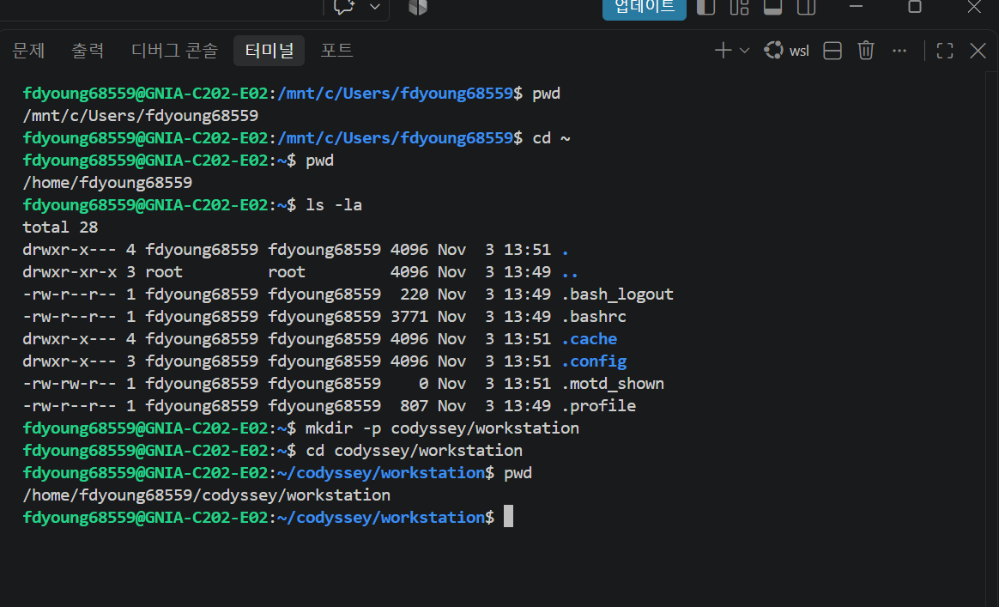

빈 파일 생성, 파일 내용 확인, 복사, 이동, 이름 변경, 삭제

```bash
$ touch empty.txt                                   # 빈 파일 생성
$ echo "Hello Codyssey" > hello.txt                 # 내용이 있는 파일 생성
$ cat hello.txt                                     # 파일 내용 확인
Hello Codyssey
$ cp hello.txt hello_copy.txt                       # 복사
$ mkdir backup
$ mv hello_copy.txt backup/                         # 이동
$ mv backup/hello_copy.txt backup/hello_backup.txt  # 이름 변경
$ rm empty.txt                                      # 삭제
$ ls -la
drwxr-xr-x 2 fdyoung68559 fdyoung68559 4096 Nov  3 13:58 backup
-rw-r--r-- 1 fdyoung68559 fdyoung68559   15 Nov  3 13:58 hello.txt
$ ls -la backup
-rw-r--r-- 1 fdyoung68559 fdyoung68559   15 Nov  3 13:58 hello_backup.txt
```

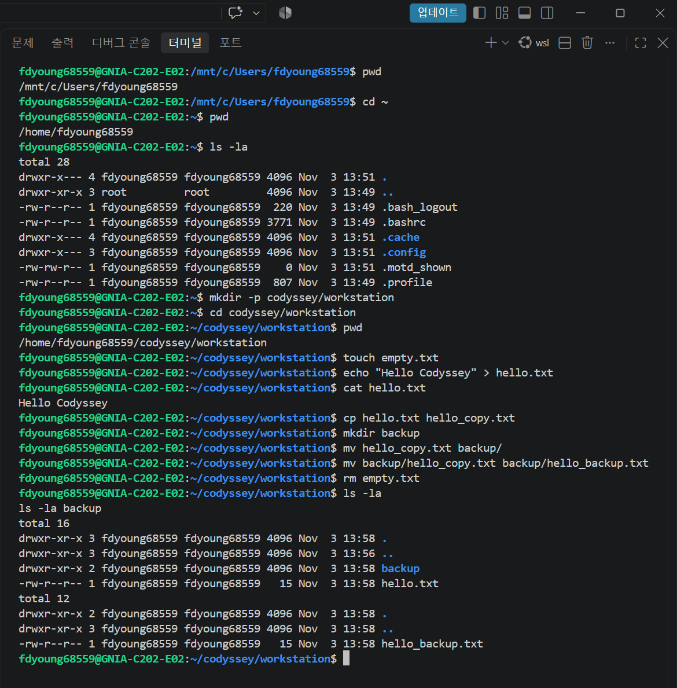

### 5-2. 권한 실습

`stat -c '%a %A %n'`으로 숫자 표기와 기호 표기를 함께 확인했습니다.

```bash
# 파일: 644 → 600
$ stat -c '%a %A %n' hello.txt
644 -rw-r--r-- hello.txt
$ chmod 600 hello.txt
$ stat -c '%a %A %n' hello.txt
600 -rw------- hello.txt

# 디렉토리: 755 → 700
$ stat -c '%a %A %n' backup
755 drwxr-xr-x backup
$ chmod 700 backup
$ stat -c '%a %A %n' backup
700 drwx------ backup
```

| 대상 | 변경 전 | 변경 후 | 의미 |
|---|---|---|---|
| `hello.txt` | 644 (`rw-r--r--`) | 600 (`rw-------`) | 소유자만 읽기·쓰기 가능, 그룹·기타는 접근 불가 |
| `backup/` | 755 (`rwxr-xr-x`) | 700 (`rwx------`) | 소유자만 목록 보기·생성·진입 가능 |

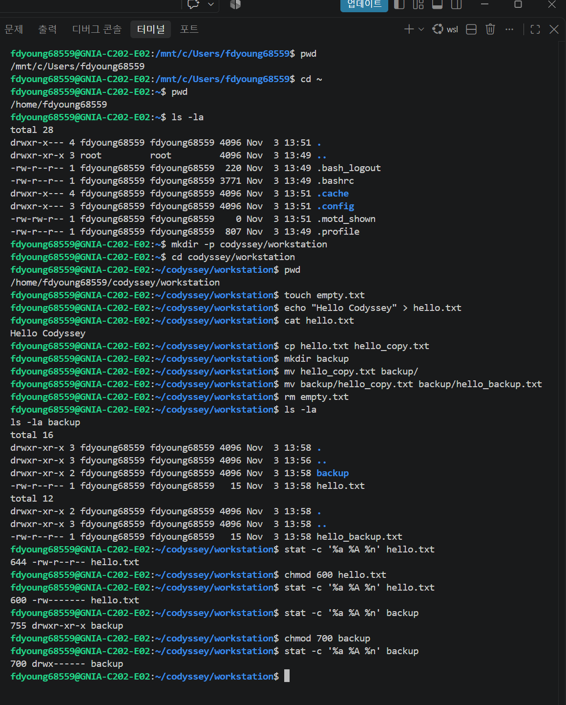

### 5-3. Docker 설치 및 점검

Docker Desktop 실행 후 `Engine running` 확인

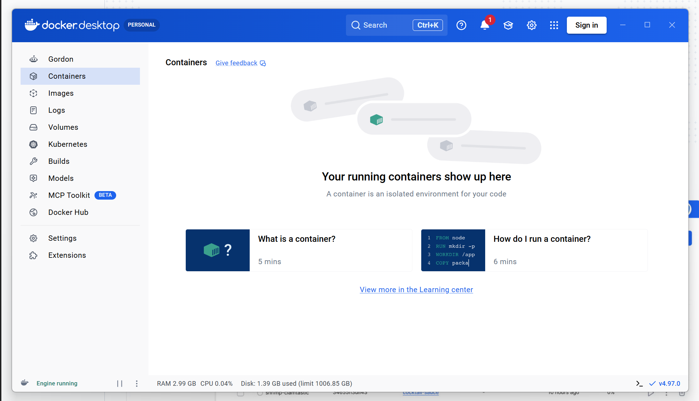

```bash
$ docker --version
Docker version 29.9.2, build a82e528

$ docker info
Client:
 Version:    29.9.2
 Context:    default
 ...
Server:
 Containers: 0
  Running: 0
  Paused: 0
  Stopped: 0
 Images: 0
 Server Version: 29.9.2
 Storage Driver: overlayfs
 ...
 Kernel Version: 6.18.54.1-microsoft-standard-WSL2
 Operating System: Docker Desktop
 OSType: linux
 Architecture: x86_64
 CPUs: 24
 Total Memory: 15.25GiB
```

`Server:` 영역이 오류 없이 출력되어 Docker 데몬이 정상 동작 중임을 확인했습니다.

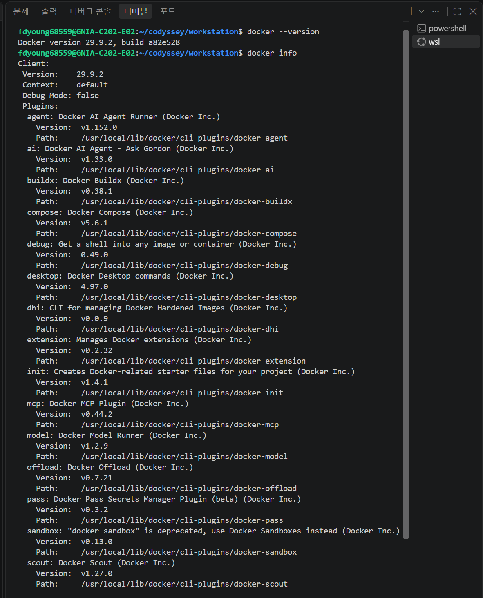
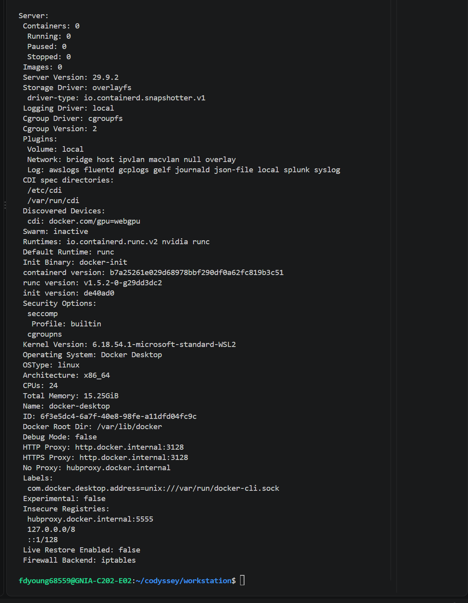

### 5-4. 컨테이너 실행 실습

**hello-world**

```bash
$ docker run hello-world
Unable to find image 'hello-world:latest' locally
latest: Pulling from library/hello-world
...
Status: Downloaded newer image for hello-world:latest

Hello from Docker!
This message shows that your installation appears to be working correctly.
...

$ docker images
IMAGE                ID             DISK USAGE   CONTENT SIZE
hello-world:latest   c567b231f656   25.9kB       9.49kB

$ docker ps -a
CONTAINER ID   IMAGE         COMMAND    CREATED          STATUS                      NAMES
0be6de0f97aa   hello-world   "/hello"   11 seconds ago   Exited (0) 11 seconds ago   inspiring_napier
```

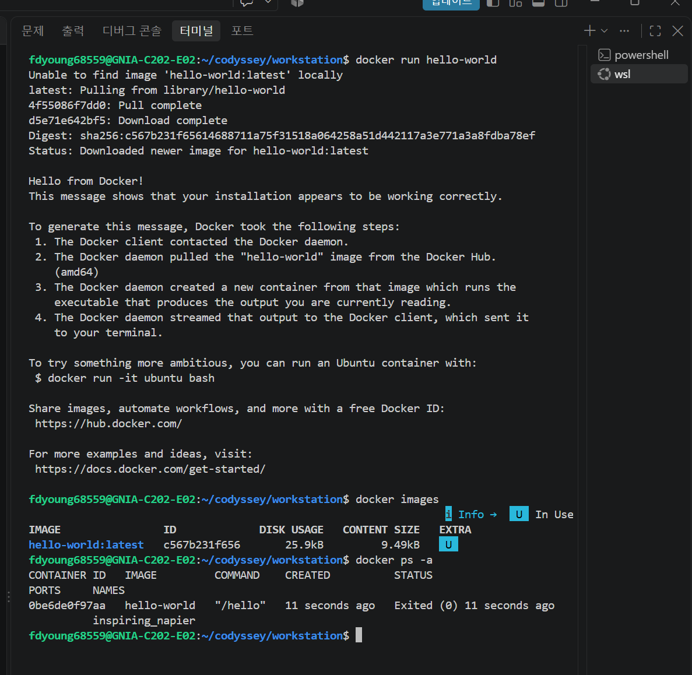

**ubuntu 컨테이너 진입**

```bash
$ docker run -it --name my-ubuntu ubuntu bash
root@5fa7fdb5d2a3:/# pwd
/
root@5fa7fdb5d2a3:/# ls
bin  boot  dev  etc  home  lib  lib64  media  mnt  opt  proc  root  run  sbin  srv  sys  tmp  usr  var
root@5fa7fdb5d2a3:/# echo "Hello from container"
Hello from container
root@5fa7fdb5d2a3:/# cat /etc/os-release
PRETTY_NAME="Ubuntu 26.04.1 LTS"
...
root@5fa7fdb5d2a3:/# exit

$ docker ps -a
CONTAINER ID   IMAGE    COMMAND   ...   STATUS                     NAMES
5fa7fdb5d2a3   ubuntu   "bash"    ...   Exited (0) 5 seconds ago   my-ubuntu
```

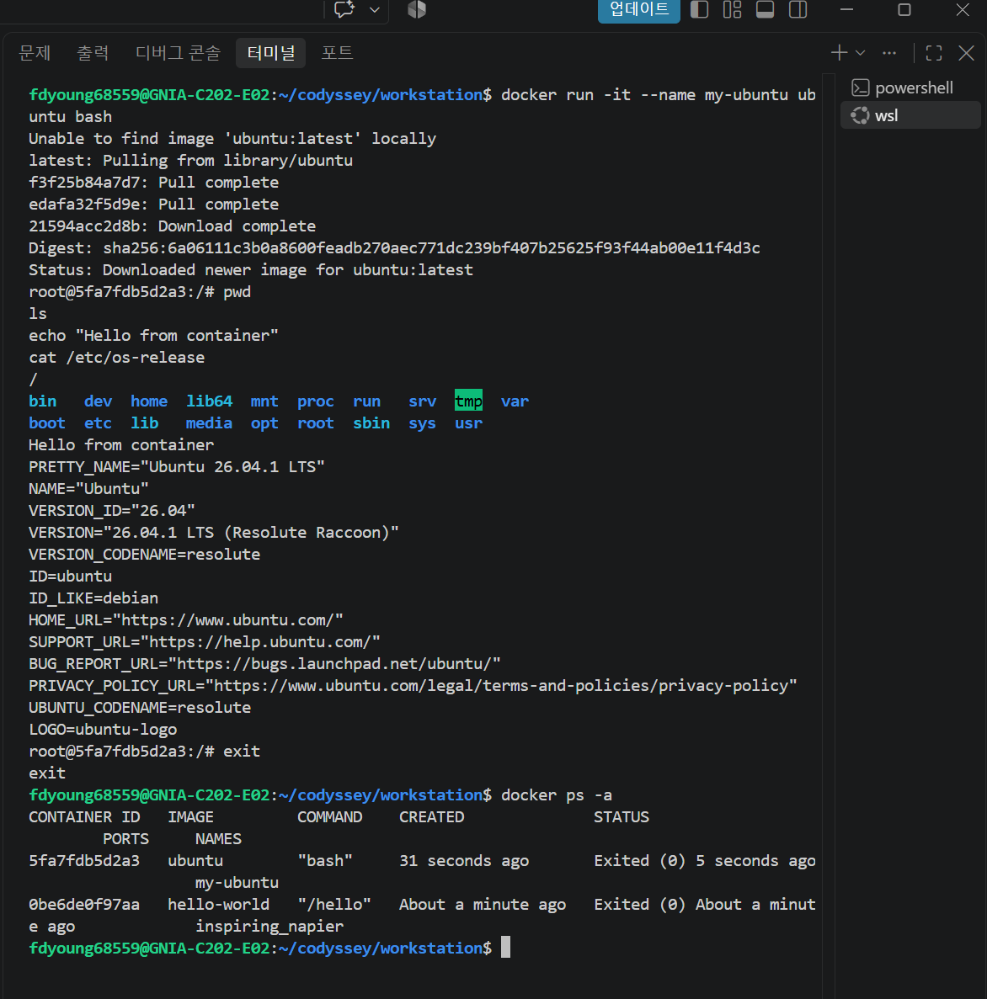

**attach와 exec 차이 관찰**

```bash
$ docker start my-ubuntu
$ docker ps
... my-ubuntu   Up 5 seconds

$ docker exec -it my-ubuntu bash
root@5fa7fdb5d2a3:/# echo "entered with exec"
entered with exec
root@5fa7fdb5d2a3:/# exit
$ docker ps
... my-ubuntu   Up 24 seconds            # exec 후 exit → 컨테이너 유지

$ docker attach my-ubuntu
root@5fa7fdb5d2a3:/# echo "entered with attach"
entered with attach
root@5fa7fdb5d2a3:/# exit
$ docker ps -a
... my-ubuntu   Exited (0) 5 seconds ago # attach 후 exit → 컨테이너 종료
```

| 명령 | 동작 | exit 후 컨테이너 |
|---|---|---|
| `docker exec` | 컨테이너 안에 **새 bash 프로세스**를 추가로 실행 | 메인 프로세스가 살아 있어 **유지(Up)** |
| `docker attach` | 이미 실행 중인 **메인 bash 프로세스**에 연결 | 메인 프로세스가 끝나 **종료(Exited)** |

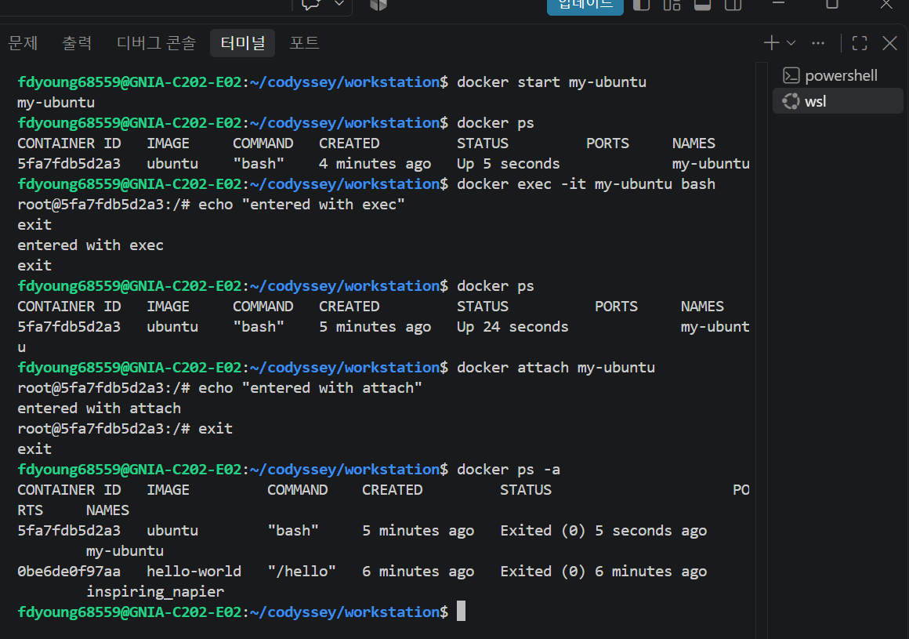

### 5-5. Docker 기본 운영 명령

```bash
$ docker run -d --name log-test ubuntu bash -c 'while true; do echo "tick $(date +%T)"; sleep 2; done'
$ docker ps
... ubuntu   "bash -c 'while true…"   Up 6 seconds   log-test

$ docker logs log-test
tick 05:19:50
tick 05:19:52
tick 05:19:54
tick 05:19:56
tick 05:19:58
tick 05:20:00

$ docker logs --tail 3 log-test
tick 05:20:02
tick 05:20:04
tick 05:20:06

$ docker stats --no-stream
CONTAINER ID   NAME       CPU %   MEM USAGE / LIMIT     MEM %   NET I/O          BLOCK I/O   PIDS
4031b4d9d718   log-test   0.62%   3.207MiB / 15.25GiB   0.02%   1.17kB / 126B    0B / 0B     2

$ docker stop log-test
$ docker ps -a
... log-test   Exited (137) 3 seconds ago
```

`Exited (137)`은 `docker stop`으로 강제 종료(SIGKILL)되었다는 의미입니다.

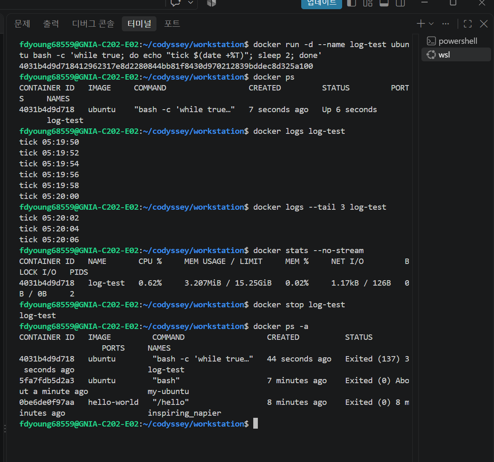

### 5-6. 기존 Dockerfile 기반 커스텀 이미지 제작

**선택한 방식: (A) 웹 서버 베이스 이미지 활용** — `nginx:alpine` 공식 이미지를 베이스로, 정적 콘텐츠만 교체했습니다.

```dockerfile
# 기존 nginx 웹 서버 이미지(가벼운 alpine 버전)를 바탕으로 시작
FROM nginx:alpine

# 이미지에 이름표(메타데이터) 붙이기
LABEL org.opencontainers.image.title="codyssey-web"

# 환경변수 설정 (실행 환경 표시용)
ENV APP_ENV=dev

# 내가 만든 웹 페이지를 nginx 기본 페이지 위치에 복사
COPY site/ /usr/share/nginx/html/

# 이 컨테이너는 80번 포트를 사용한다고 표시
EXPOSE 80
```

| 커스텀 포인트 | 목적 |
|---|---|
| `FROM nginx:alpine` | 검증된 공식 웹 서버 이미지를 재사용하고, alpine으로 용량을 줄임 |
| `LABEL` | 이미지에 제목 메타데이터를 붙여 식별하기 쉽게 함 |
| `ENV APP_ENV=dev` | 실행 환경(개발용)을 환경변수로 표시 |
| `COPY site/ ...` | nginx 기본 페이지를 내가 만든 `index.html`로 교체 |
| `EXPOSE 80` | 컨테이너가 사용하는 포트를 문서화 |

```bash
$ docker build -t my-web:1.0 .
[+] Building 4.9s (7/7) FINISHED
 => [internal] load build definition from Dockerfile
 => [internal] load metadata for docker.io/library/nginx:alpine
 => [1/2] FROM docker.io/library/nginx:alpine@sha256:785835ea...
 => [2/2] COPY site/ /usr/share/nginx/html/
 => exporting to image
 => => naming to docker.io/library/my-web:1.0

$ docker images
IMAGE                ID             DISK USAGE   CONTENT SIZE
hello-world:latest   c567b231f656   25.9kB       9.49kB
my-web:1.0           acd065ee5f41   93.6MB       26.3MB
ubuntu:latest        6a06111c3b0a   163MB        45.9MB
```

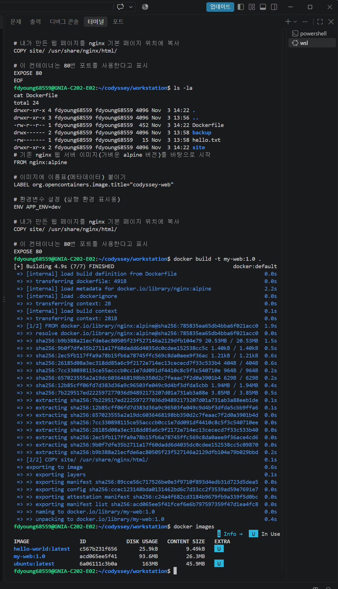

### 5-7. 포트 매핑 및 접속

같은 이미지로 컨테이너 2개를 실행하고, 호스트 포트만 다르게 연결했습니다.

```bash
$ docker run -d -p 8080:80 --name my-web-8080 my-web:1.0
$ docker run -d -p 8081:80 --name my-web-8081 my-web:1.0

$ docker ps
IMAGE        ...   STATUS          PORTS                                     NAMES
my-web:1.0   ...   Up 5 seconds    0.0.0.0:8081->80/tcp, [::]:8081->80/tcp   my-web-8081
my-web:1.0   ...   Up 18 seconds   0.0.0.0:8080->80/tcp, [::]:8080->80/tcp   my-web-8080

$ curl http://localhost:8080
...
  <h1>Hello Codyssey!</h1>
  <p>나만의 커스텀 nginx 웹 서버입니다.</p>
...

$ curl http://localhost:8081
...
  <h1>Hello Codyssey!</h1>
...
```

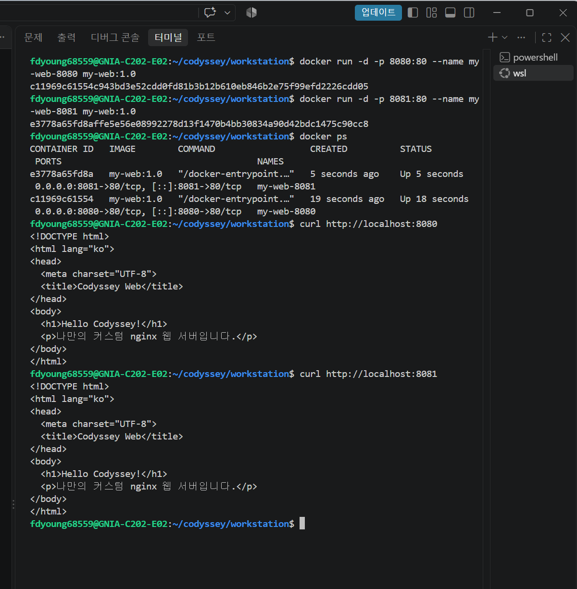

브라우저 접속 (주소창 포트 포함)

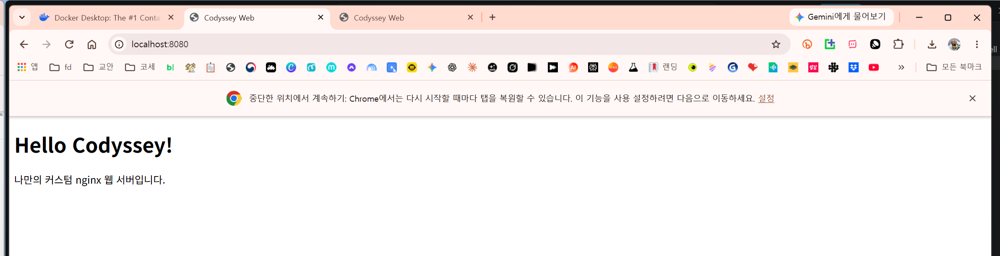
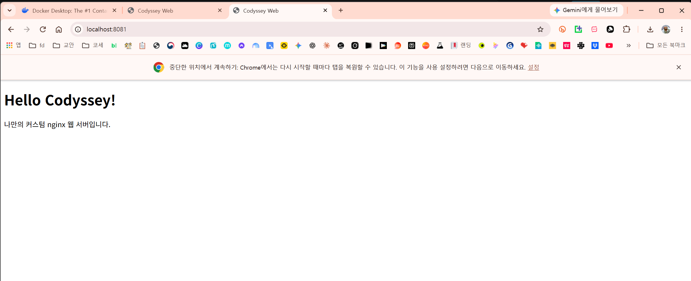

### 5-8. 바인드 마운트 반영

원본 `site`는 유지하기 위해 `bind-site`로 복사한 뒤, 호스트 폴더를 컨테이너의 nginx 웹 루트에 연결했습니다.

```bash
$ cp -r site bind-site
$ docker run -d -p 8082:80 --name my-web-bind \
    -v $(pwd)/bind-site:/usr/share/nginx/html nginx:alpine

# 변경 전
$ curl http://localhost:8082
  <h1>Hello Codyssey!</h1>

# 호스트에서 파일만 수정 (컨테이너 재시작·재빌드 없음)
$ sed -i 's/Hello Codyssey!/Hello Bind Mount! (수정됨)/' bind-site/index.html

# 변경 후
$ curl http://localhost:8082
  <h1>Hello Bind Mount! (수정됨)</h1>
```

| | 변경 전 | 변경 후 |
|---|---|---|
| 터미널 | 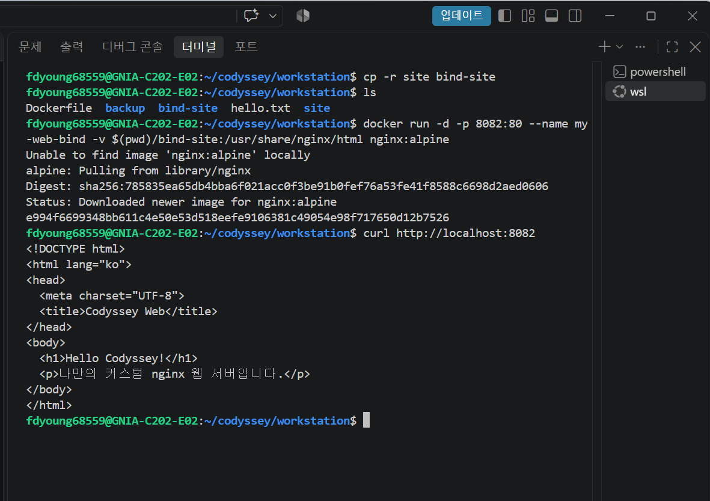 | 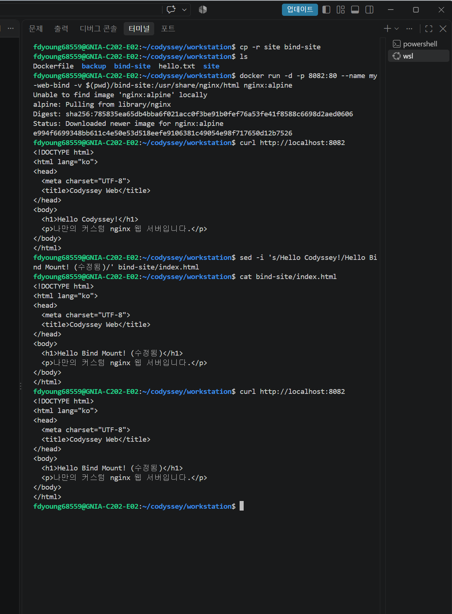 |
| 브라우저 | 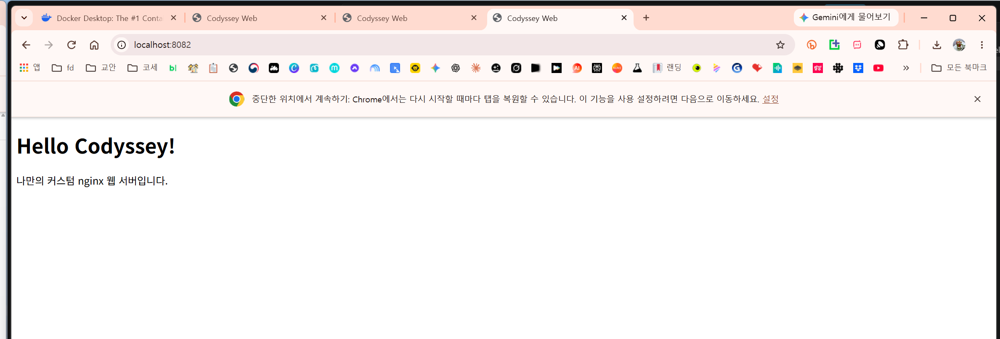 | 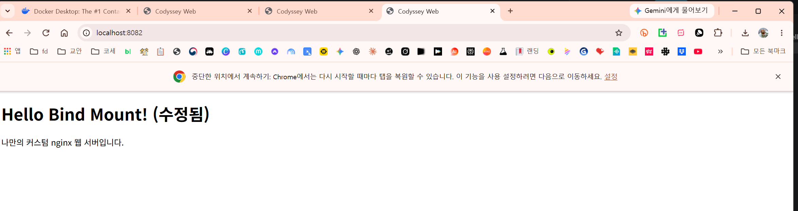 |

### 5-9. Docker 볼륨 영속성

```bash
$ docker volume create mydata
mydata
$ docker volume ls
DRIVER    VOLUME NAME
local     mydata

$ docker run -d --name vol-test1 -v mydata:/data ubuntu sleep infinity
$ docker exec vol-test1 sh -c "echo 'persistent data test' > /data/hello.txt"
$ docker exec vol-test1 cat /data/hello.txt
persistent data test

# 컨테이너 삭제
$ docker rm -f vol-test1
vol-test1
$ docker ps -a                     # vol-test1 없음

# 같은 볼륨으로 새 컨테이너 실행
$ docker run -d --name vol-test2 -v mydata:/data ubuntu sleep infinity
$ docker exec vol-test2 cat /data/hello.txt
persistent data test               # 컨테이너를 삭제해도 데이터 유지
```

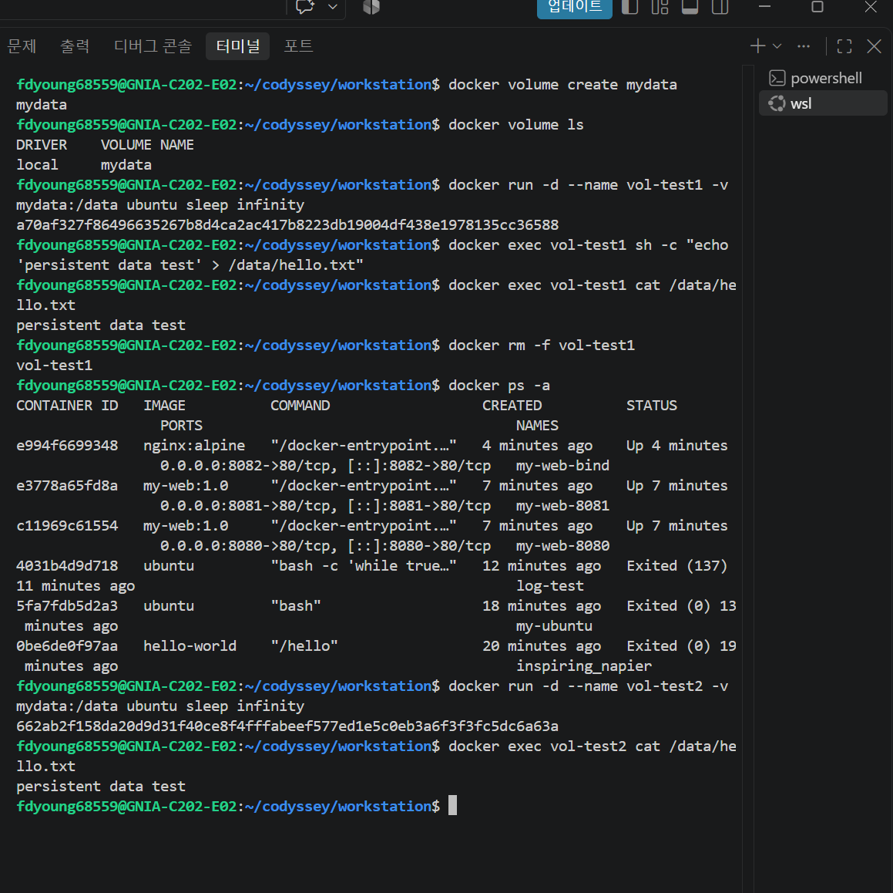

### 5-10. Git 설정 및 GitHub 연동

**Git 설정** (이메일은 개인정보 보호를 위해 마스킹)

```bash
$ git --version
git version 2.53.0
$ git config --global user.name "fdyoung9-a11y"
$ git config --global user.email "(마스킹)"
$ git config --global init.defaultBranch main
$ git config --list
user.name=fdyoung9-a11y
user.email=(마스킹)
init.defaultbranch=main
```

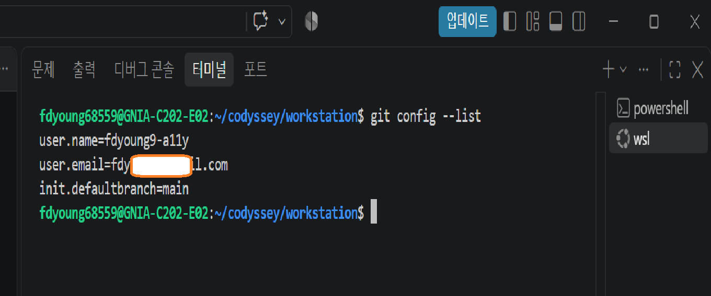

**GitHub 저장소 생성 → 로컬 저장소 연결 → 첫 커밋**

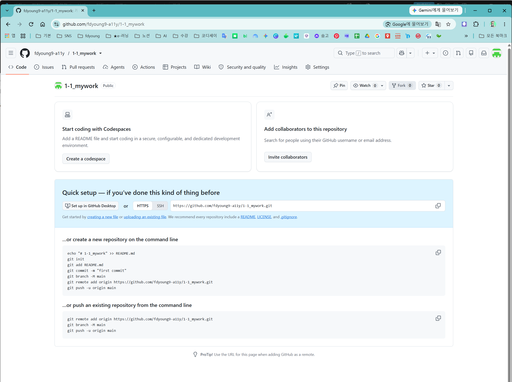

```bash
$ git init
Initialized empty Git repository in /home/fdyoung68559/codyssey/workstation/.git/
$ git add .
$ git commit -m "feat: 터미널 실습 파일과 Dockerfile 기반 커스텀 웹 서버 추가"
[main (root-commit) 3ff5b07] feat: 터미널 실습 파일과 Dockerfile 기반 커스텀 웹 서버 추가
 6 files changed, 47 insertions(+)
$ git remote add origin https://github.com/fdyoung9-a11y/1-1_mywork.git
$ git remote -v
origin  https://github.com/fdyoung9-a11y/1-1_mywork.git (fetch)
origin  https://github.com/fdyoung9-a11y/1-1_mywork.git (push)
```

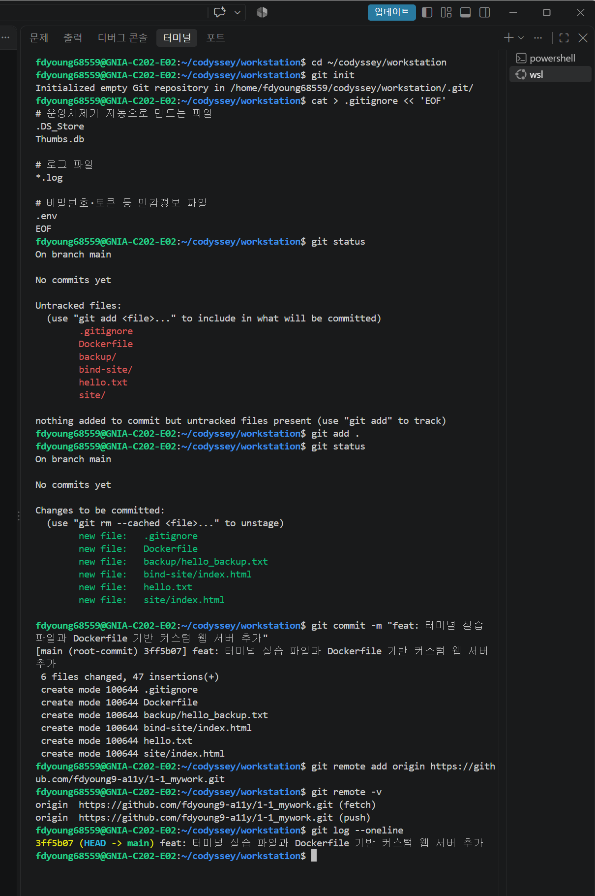

**VSCode WSL 모드로 저장소 열기 + GitHub 로그인**

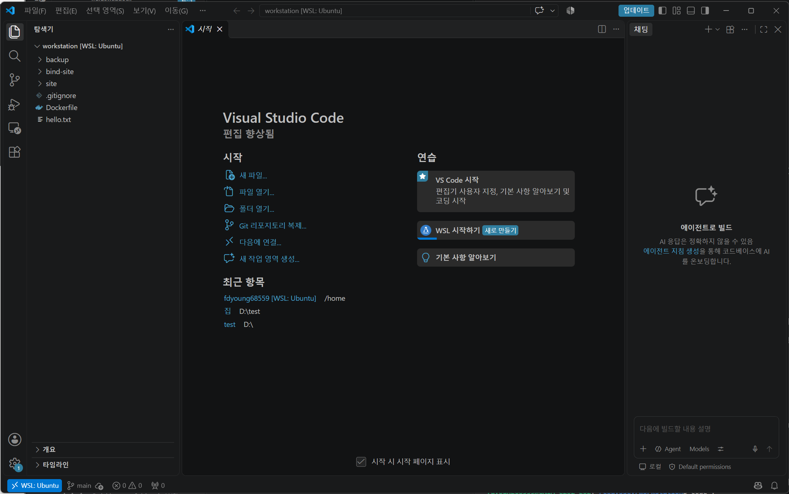
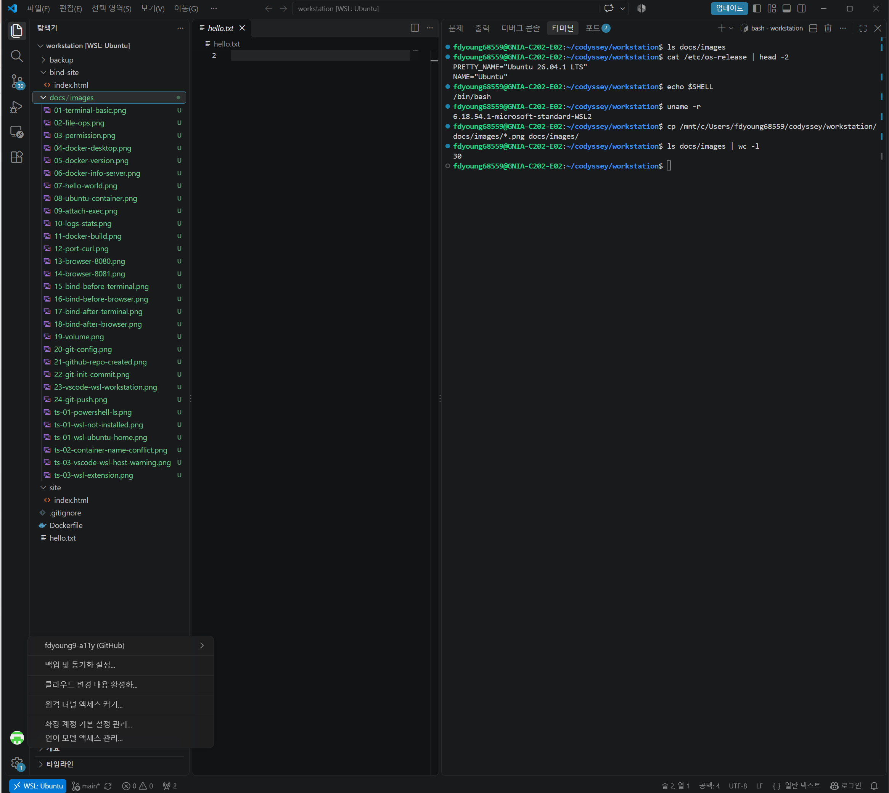

**push**

```bash
$ git push -u origin main
...
To https://github.com/fdyoung9-a11y/1-1_mywork.git
 * [new branch]      main -> main
branch 'main' set up to track 'origin/main'.
$ git log --oneline
3ff5b07 (HEAD -> main, origin/main) feat: 터미널 실습 파일과 Dockerfile 기반 커스텀 웹 서버 추가
```

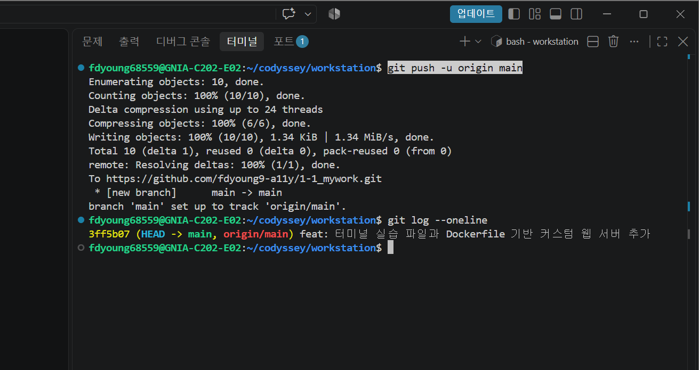

---

## 6. 검증 방법 요약

| 항목 | 사용한 명령 | 확인한 내용 | 증거 |
|---|---|---|---|
| 터미널 조작 | `pwd`, `ls -la`, `cp`, `mv`, `rm` | 위치·목록·파일 변화 | [5-1](#5-1-터미널-기본-조작) |
| 권한 | `stat -c '%a %A %n'`, `chmod` | 644→600, 755→700 | [5-2](#5-2-권한-실습) |
| Docker 동작 | `docker --version`, `docker info` | 버전 29.9.2, Server 정상 응답 | [5-3](#5-3-docker-설치-및-점검) |
| 컨테이너 실행 | `docker run hello-world`, `docker ps -a` | `Hello from Docker!`, `Exited (0)` | [5-4](#5-4-컨테이너-실행-실습) |
| attach/exec | `docker exec`, `docker attach`, `docker ps` | exec 후 Up, attach 후 Exited | [5-4](#5-4-컨테이너-실행-실습) |
| 운영 명령 | `docker logs`, `docker stats`, `docker stop` | 로그 출력, CPU·메모리 사용량 | [5-5](#5-5-docker-기본-운영-명령) |
| 커스텀 이미지 | `docker build`, `docker images` | `FINISHED`, `my-web:1.0` 생성 | [5-6](#5-6-기존-dockerfile-기반-커스텀-이미지-제작) |
| 포트 매핑 | `docker ps`, `curl`, 브라우저 | 8080·8081 모두 응답 | [5-7](#5-7-포트-매핑-및-접속) |
| 바인드 마운트 | `sed`, `curl`, 브라우저 | 재시작 없이 내용 변경 반영 | [5-8](#5-8-바인드-마운트-반영) |
| 볼륨 | `docker rm -f`, `docker exec ... cat` | 컨테이너 삭제 후에도 데이터 유지 | [5-9](#5-9-docker-볼륨-영속성) |
| Git/GitHub | `git config --list`, `git push`, `git log` | 설정 3줄, `origin/main` 동기화 | [5-10](#5-10-git-설정-및-github-연동) |

---

## 7. 트러블슈팅

### 7-1. PowerShell에서 리눅스 명령이 동작하지 않음

- **문제**: VSCode 기본 터미널(PowerShell)에서 `ls -la` 실행 시 `매개 변수 이름 'la'과(와) 일치하는 매개 변수를 찾을 수 없습니다` 오류
- **원인 가설**: PowerShell의 `ls`는 리눅스 `ls`가 아니라 `Get-ChildItem`의 별칭이라 `-la` 옵션을 모를 것
- **확인**: 터미널이 `PS C:\...>` 형태의 PowerShell임을 확인, `wsl -l -v` 실행 시 WSL 미설치 안내 출력
- **해결**: 관리자 PowerShell에서 `wsl --install -d Ubuntu`로 WSL Ubuntu 설치 → VSCode 터미널을 Ubuntu(WSL)로 전환 후 정상 동작

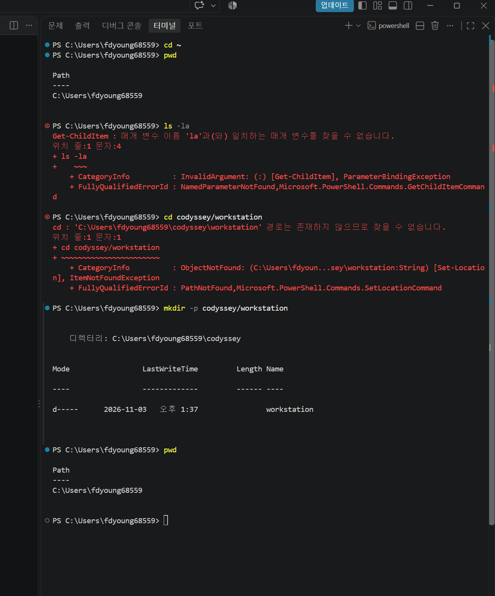
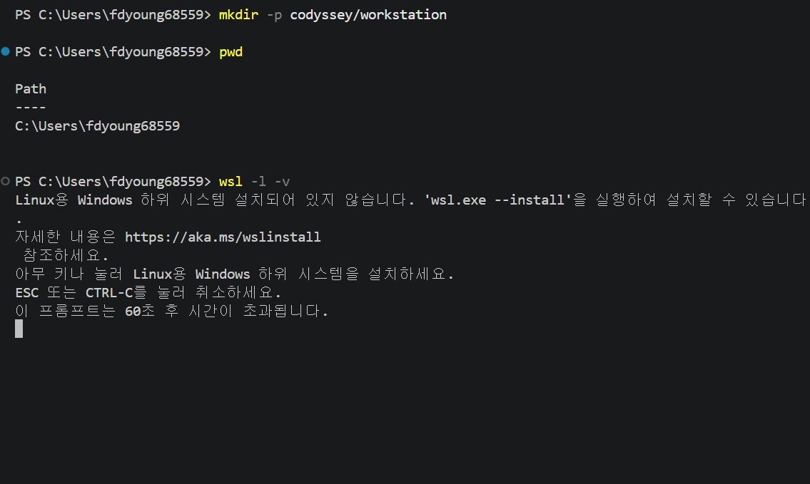
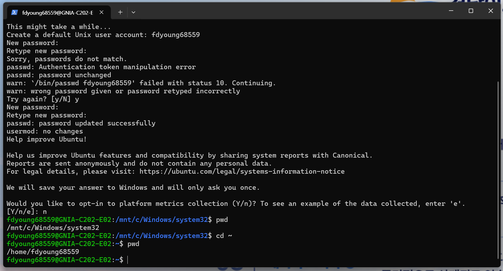

### 7-2. 같은 이름의 컨테이너 생성 시 Conflict 오류

- **문제**: 볼륨 실습을 다시 실행할 때 `docker run --name vol-test2 ...`에서 `Conflict. The container name "/vol-test2" is already in use` 오류
- **원인 가설**: 이전 실습에서 만든 `vol-test2` 컨테이너가 아직 남아 있을 것
- **확인**: `docker ps -a`에서 `vol-test2`가 `Up` 상태로 존재함을 확인
- **해결**: 기존 컨테이너를 그대로 사용해 `docker exec vol-test2 cat /data/hello.txt`로 검증. 새로 만들려면 `docker rm -f vol-test2` 후 다시 실행

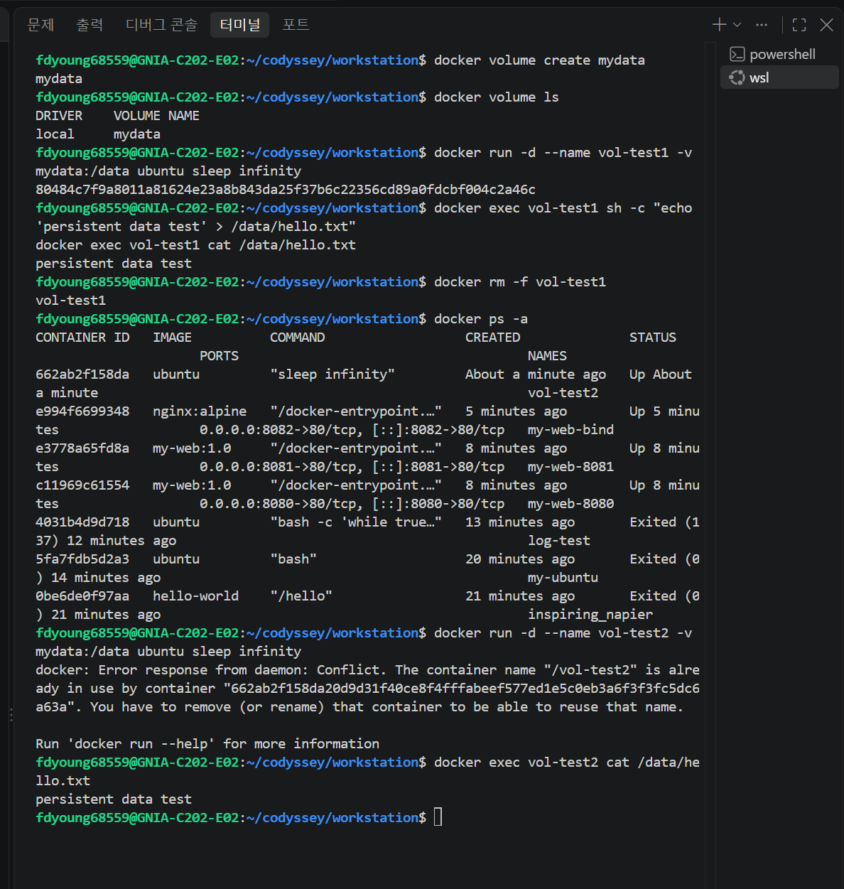

### 7-3. VSCode에서 `wsl.localhost` 호스트 경고

- **문제**: WSL 터미널에서 `code .` 실행 시 "허용된 호스트 목록에서 'wsl.localhost' 호스트를 찾을 수 없습니다" 경고
- **원인 가설**: VSCode에 WSL 확장이 없어 Ubuntu 폴더를 Windows 네트워크 경로(`\\wsl.localhost\...`)로 우회해서 열려고 함
- **확인**: 확장 목록에 Microsoft WSL 확장이 설치되어 있지 않음
- **해결**: 경고창은 취소 → WSL 확장(Microsoft) 설치 → `code .` 재실행 → 왼쪽 아래 `WSL: Ubuntu` 표시와 함께 정상 연결

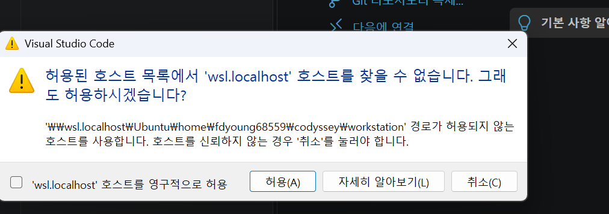
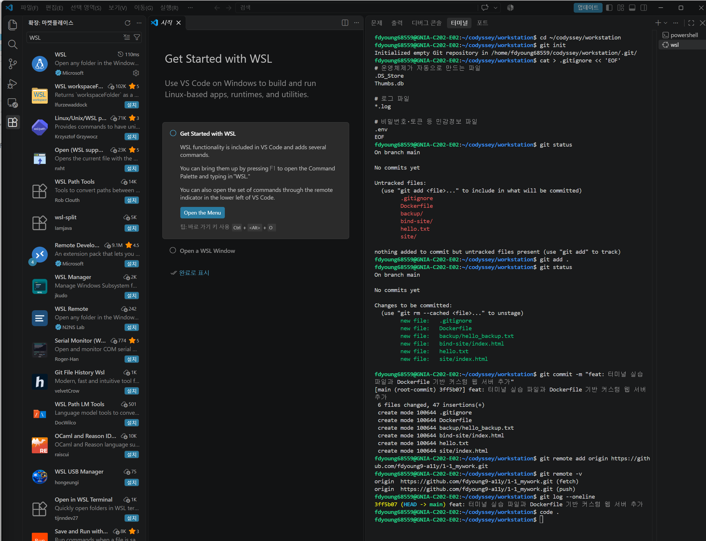

### 7-4. 스크린샷이 저장소 폴더에 보이지 않음 (Windows 경로 vs Ubuntu 경로)

- **문제**: 이미지를 `docs/images`에 복사했는데 Ubuntu에서 `ls docs/images` 결과가 비어 있음
- **원인 가설**: 같은 이름의 폴더가 Windows와 Ubuntu에 따로 있어서 다른 곳에 복사했을 것
- **확인**: 파일 탐색기 경로가 `C:\Users\fdyoung68559\codyssey\workstation\docs\images`(Windows)였고, 실제 저장소는 `/home/fdyoung68559/codyssey/workstation`(Ubuntu)
- **해결**: Ubuntu에서 Windows C 드라이브는 `/mnt/c`로 보이므로 `cp /mnt/c/Users/fdyoung68559/codyssey/workstation/docs/images/*.png docs/images/`로 복사

### 7-5. Git 사용자 이름에 줄바꿈이 함께 저장됨

- **문제**: `git config --list`에서 `user.name` 다음에 빈 줄이 출력됨
- **원인 가설**: 이름 입력 중 닫는 따옴표 전에 Enter가 눌려 줄바꿈 문자가 함께 저장되었을 것
- **확인**: `user.name=fdyoung9-a11y` 아래 빈 줄 존재
- **해결**: `git config --global user.name "fdyoung9-a11y"`를 한 줄로 다시 실행해 덮어씀

---

## 8. 개념 정리

### 절대 경로와 상대 경로

- **절대 경로**는 루트(`/`)부터 시작하는 전체 주소로, 현재 위치와 관계없이 항상 같은 곳을 가리킵니다. 예: `/home/fdyoung68559/codyssey/workstation/hello.txt`
- **상대 경로**는 현재 위치를 기준으로 한 주소입니다. 예: `~/codyssey/workstation`에서 `cat hello.txt`, `cd ..`(한 단계 위), `./`(현재 폴더)
- 바인드 마운트(`-v $(pwd)/bind-site:...`)처럼 정확한 위치가 필요한 곳에서는 절대 경로를 사용했습니다.

### 파일 권한 (r/w/x, 755, 644)

- `r`(읽기)=4, `w`(쓰기)=2, `x`(실행, 디렉토리는 진입)=1이며, **소유자/그룹/기타** 세 자리로 각각 더해 표기합니다.
- `755` = 7(rwx) / 5(r-x) / 5(r-x) → 실행 파일·디렉토리에 주로 사용
- `644` = 6(rw-) / 4(r--) / 4(r--) → 일반 파일에 주로 사용

### 커스텀 이미지

- 이미지는 실행 환경을 묶은 읽기 전용 설계도이고, 컨테이너는 그 이미지를 실행한 인스턴스입니다.
- 기존 `nginx:alpine` 이미지를 `FROM`으로 가져오고, `COPY`로 내 콘텐츠만 바꿔 `my-web:1.0`을 만들었습니다. 같은 이미지로 컨테이너를 여러 개 띄워도 동일하게 재현됩니다.

### 포트 매핑이 필요한 이유

- 컨테이너는 호스트와 분리된 네트워크 공간에서 실행되어, 컨테이너 내부 포트(80)에 호스트가 직접 접근할 수 없습니다.
- `-p 호스트포트:컨테이너포트`로 연결해야 외부에서 접속할 수 있고, 호스트 포트만 다르게 하면 같은 이미지를 여러 개 동시에 띄울 수 있습니다(8080, 8081).

### Docker 볼륨 (영속 데이터)

- 컨테이너 내부에 저장한 데이터는 컨테이너를 삭제하면 함께 사라집니다.
- 볼륨은 Docker가 관리하는 별도 저장 공간이라, 컨테이너를 삭제해도 남고 새 컨테이너에 다시 연결해 쓸 수 있습니다.
- 바인드 마운트는 내가 지정한 호스트 폴더를 연결하므로 개발 중 파일 수정을 바로 반영할 때 유용합니다.

### Git과 GitHub의 역할 차이

| | Git | GitHub |
|---|---|---|
| 정체 | 버전 관리 프로그램 | Git 저장소 호스팅 서비스 |
| 위치 | 내 컴퓨터(로컬) | 인터넷(원격) |
| 역할 | 변경 이력 기록(`commit`), 되돌리기 | 저장소 공유, 협업, 공개(`push`/`pull`) |

---

## 9. 보안 및 개인정보

- Git 설정의 이메일은 문서와 스크린샷에서 마스킹했습니다.
- GitHub 인증은 VSCode의 GitHub 로그인으로 처리해 토큰·비밀번호를 터미널이나 문서에 남기지 않았습니다.
- `.gitignore`에 `.env`, `*.log`를 등록해 민감정보 파일이 실수로 올라가지 않도록 했습니다.
